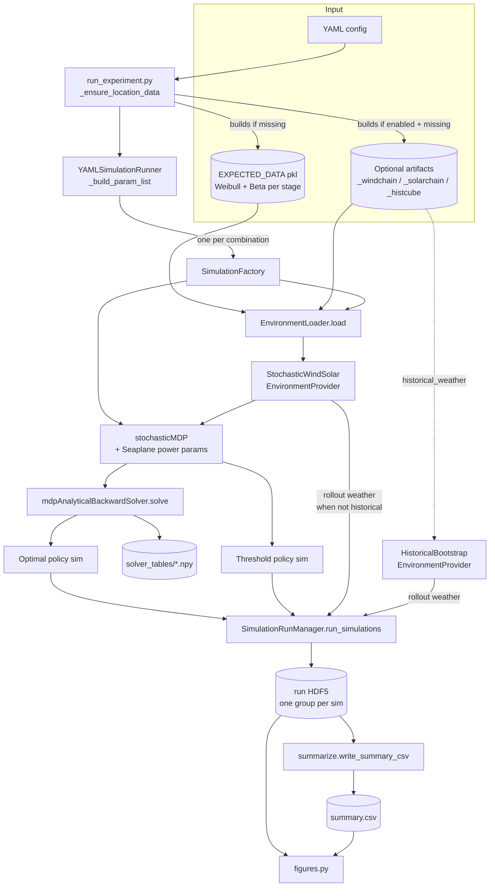

# Architecture

This page maps the main components and shows how one experiment moves through them, from the
YAML config to `summary.csv`. Later pages cover each stage:
[The MDP](mdp.md), [Solver](solver.md), [Episode simulation](simulation.md),
[Result storage](storage.md).

## Components

| Component | Module | Role |
|---|---|---|
| Harness CLI | `harness/run_experiment.py` | Expands a YAML config, provisions data, builds and runs simulations, writes the run directory |
| Config expansion | `BaseClasses/run_sim.py` · `YAMLSimulationRunner` | Reads the YAML and builds the cross-product parameter list |
| Per-simulation setup | `BaseClasses/run_sim.py` · `SimulationFactory`, `EnvironmentLoader` | Loads weather artifacts, builds environment providers, the MDP, and the solver or policy |
| Aircraft model | `BaseClasses/seaplane_base.py` · `Seaplane` | Idle, cruise, takeoff and landing power; climb and descent times |
| Weather | `BaseClasses/environment_provider_base.py` | `StochasticWindSolarEnvironmentProvider` (fitted distributions and chains), `HistoricalBootstrapEnvironmentProvider` (real weather) |
| Solar panel | `BaseClasses/solar_panel_base.py` | Converts irradiance to harvested energy |
| Whale reward | `BaseClasses/whale_base.py` · `WhaleRewardSeriesFactory` | Per-stage observation-probability series |
| MDP | `BaseClasses/mdp_base.py` · `stochasticMDP` | States, actions, reward, observation gain |
| Transitions | `BaseClasses/transition_model_base.py` | Energy bookkeeping (`StochasticTransitionLogic`) and wind-dependent action success (`ProbabilityModelFactory`) |
| Solver | `BaseClasses/backward_induction_base.py` · `mdpAnalyticalBackwardSolver` | Analytical backward induction; writes the value table |
| Policies and rollouts | `BaseClasses/simulation_base.py` | `OptimalContinuousAnalyticalPolicySimulation`, `UnifiedThresholdContinuousSimulation`; batched episode rollout |
| Execution and storage | `BaseClasses/simulation_run_manager.py`, `BaseClasses/simulation_storage.py` | Runs simulations (optionally in parallel) into one HDF5 file |
| Summary and figures | `harness/summarize.py`, `harness/figures.py` | `summary.csv`, sweep plots, paper figures, trajectory replay |

All module paths are relative to `SolarSimulator/`, the import root.

## Data flow

### Step by step

1. **Provision.** `run_experiment` makes the config's paths absolute, then calls
   `_ensure_location_data` for each location. It builds any missing artifact: the expected-data
   pickle, a wind chain (also rebuilt when the configured binning changed), a solar chain, or a
   historical cube. If the raw historical record isn't on disk, it fetches it from Open-Meteo
   first. See [Weather data pipeline](../models/weather-data.md).
2. **Expand.** `YAMLSimulationRunner._build_param_list` loops over start datetimes and takes
   the cross-product of locations × horizons × failure penalties × capacities. Threshold
   simulations add observation thresholds × wind thresholds on top. Optimal simulations are
   added unless `include_optimal: false`.
3. **Set up.** Each `SimulationFactory`:
    1. slices a `horizon`-long window of stage distributions starting at `start_datetime`
       out of the expected-data pickle (`EnvironmentLoader`);
    2. builds the whale series and, when chains are enabled, the per-stage transition
       matrices;
    3. constructs the solve-side environment provider;
    4. when `historical_weather.enabled`, also builds a bootstrap provider that is used only
       for rollouts.
4. **Solve.** `create_simulation("optimal", ...)` builds the MDP (`build_mdp`), which pulls
   power parameters from `Seaplane.get_mdp_power_params()`. It wraps the MDP in an
   `mdpAnalyticalBackwardSolver`. The constructor of `OptimalContinuousAnalyticalPolicySimulation`
   calls `solve()`, so the solve happens while simulations are being built, in the build pool.
   Threshold simulations skip the solve.
5. **Roll out.** `SimulationRunManager` runs each simulation's episodes as one vectorized batch
   (`simulate_episode_batch`). Simulations run in parallel across processes; episodes within a
   simulation run together in one process.
6. **Store.** Each simulation becomes a top-level HDF5 group: summary attributes, columnar
   per-episode scalars, and optional full histories. See [Result storage](storage.md).
7. **Summarize.** `summary.csv` has one row per group, plus config-wide columns. Figures are
   either generic sweep plots or a named journal figure (`paper_figure`). A trajectory replay
   is also drawn. See [Outputs](../experiments/outputs.md).

## Solve side vs rollout side

The solver and the rollouts see weather through the same environment-provider interface, but
the two sides can differ:

| | Solve side (value table) | Rollout side (episodes) |
|---|---|---|
| Weather model | Fitted per-stage distributions: Weibull wind, Beta clear-sky index; plus chains if enabled | The same provider, **or** the historical block bootstrap when `historical_weather.enabled` |
| Energy | Discretized SoC grid (`energy_increment_wh`) | Continuous energy, re-binned to SoC after each step |
| Expectations | Analytical: Beta CDF for solar, quadrature over Weibull wind | Monte Carlo samples |

This split lets a policy solved on fitted distributions be evaluated on real historical
weather. See [Weather modes](../models/weather-modes.md).

## Entry points

| Entry point | Use |
|---|---|
| `harness/run_experiment.py experiment <yaml or dir>` | The standard way to run an experiment (see [Experiments](../experiments/index.md)) |
| `BaseClasses/run_sim.py -c <yaml> [-p]` | The original driver: the same `YAMLSimulationRunner`, writing a single HDF5 to `storage_dir` without the harness run directory |
| `gui/gui.py`, `gui/run_batch.py` | Legacy GUI and batch runner (see [GUI and tools](../experiments/gui-and-tools.md)) |
| `Scripts/run_chain_sweep.py` | Runs a whole directory of generated sweep configs (see [Sweeps](../experiments/sweeps.md)) |
| `Tests/verify_*.py` | Feature verification (see [Verification](../verification/index.md)) |
