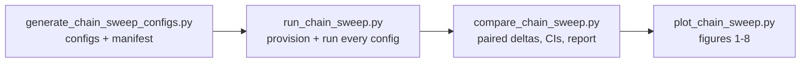

# Sweeps

Two families of multi-config experiments live in `configs/`:

| Directory | Produced by | Purpose |
|---|---|---|
| `configs/chain_vs_iid_sweep/` | `Scripts/generate_chain_sweep_configs.py` | The wind-persistence evaluation: chain-solved vs i.i.d.-solved optimal policies, plus the threshold benchmark |
| `configs/chain_vs_iid_sweep_smoke/` | same, with `--smoke` | A small, fast version for testing the pipeline end to end |
| `configs/final_journal_configs/` | hand-written | The sweeps behind the journal-paper figures |

The two sweep directories are **generated**. Change the generator and regenerate rather than editing the YAML files by hand.

## Chain-vs-i.i.d. evaluation sweep

The pipeline has four stages, all run from `SolarSimulator/` in the `pvlib` env:



API docs for all four scripts: [Scripts](../api/scripts.md#chain-vs-iid-sweep-pipeline). The findings and their interpretation are in the design records ([Briefing](../design/wind-persistence-briefing.md), [Threshold benchmark](../design/wind-threshold-benchmark.md)) and [Findings](../findings.md).

### 1. Generate configs

```bash
python Scripts/generate_chain_sweep_configs.py                  # full sweep
python Scripts/generate_chain_sweep_configs.py --smoke          # tiny variant
python Scripts/generate_chain_sweep_configs.py --full-date-grid # start-date sweep at every location
python Scripts/generate_chain_sweep_configs.py --thresholds     # also emit threshold-benchmark configs
```

`--out DIR` overrides the output directory. The default is `configs/chain_vs_iid_sweep[_smoke]`.

The configs come in **matched pairs** that differ **only** in `wind_chain.enabled` (the *arm*: `iid` or `chain`) and `historical_weather` (the *world*). Any difference within a pair is therefore attributable to the chain formulation alone.

| Axis | Values | Meaning |
|---|---|---|
| arm | `iid`, `chain` | How the optimal policy is solved |
| world | `hist` | Episodes are rolled out on block-bootstrapped historical weather. This is the fair comparison: paired runs see identical weather episode for episode, because the bootstrap provider is reset with a fixed seed per batch. |
| world | `native` | Episodes are rolled out in the arm's own assumed synthetic world. This measures the solver's self-predicted performance and is used for calibration. |
| arm `thresh` | hist world only | With `--thresholds`: one arm-agnostic config per scenario running the full observation × wind threshold grid (`include_optimal: false`, no solve). |

The sweeps form a star design around one baseline point:

| Sweep | Swept field | Values | Locations |
|---|---|---|---|
| `capgrid` | `battery_capacities` | 150, 200, 250, 300, 400, 500 Wh | all four (one config per location, so value-table file names never collide) |
| `startdate` | `start_datetimes` | 1st of Jan, Mar, May, Jul, Sep, Nov 2020 | baseline only (every location with `--full-date-grid`) |
| `duration` | `horizons` | 672, 1344, 2880, 5760 steps (7 / 14 / 30 / 60 days) | baseline only |

Fixed settings, as constants in the generator:

| Setting | Value |
|---|---|
| Baseline | lat 30 / lon −90, 300 Wh, start 2020-07-01, horizon 2880 (30 days) |
| Locations | (30, −90) Gulf of Mexico; (20, −159) Hawaii; (45, −100) continental US; (58, −161) Bering Sea |
| Wind bins | `wind_chain: {n_bins: 4}` with no `bin_edges`, so quantile bins are derived per location |
| Historical blocks | 7 days |
| Episodes | 3000 (smoke: 200) |
| Other keys | failure penalty 5, `transition_model: moderate`, `solar_panel_model: constant`, `whale_series: JoA2026`, `energy_increment_wh: 5`, `delta_t: 15` |
| Threshold grid | observation {0, 0.05, …, 0.3} × wind {0, 3, 6, 9, 12} m/s |
| Full histories | 64 episodes, **only** in the baseline-location `capgrid` hist pair, because only the event-aligned composites and trajectory figures read them. Every other config stores scalars only (`full_history_episodes: 0`). |

Config names follow `cvi_<sweep>_lat<lat>_lon<lon>_<arm>_<world>.yaml` (prefix `smoke_cvi` for the smoke variant). The generator also writes `chain_vs_iid_sweep_manifest.json`. It records the generation settings, the baseline, and one entry per config with its `pair_key` (arm replaced by `ARM`) and `world_key` (world replaced by `WORLD`). The comparison script joins pairs through these keys.

### 2. Run

```bash
conda run -n pvlib python Scripts/run_chain_sweep.py --provision-only
conda run -n pvlib python Scripts/run_chain_sweep.py --smoke
conda run -n pvlib python Scripts/run_chain_sweep.py --workers 8 --resume
```

`run_chain_sweep.py` is a thin wrapper around the harness's `run_experiment`. It adds three things:

- **Up-front provisioning.** The Open-Meteo fetch and the wind-chain and historical-cube builds run first, so network or build failures show up before hours of solving. `--provision-only` stops after this step.
- **`--resume`.** Skips configs that already have a run folder containing a `summary.csv`.
- **Timing log.** Each config's wall time is appended to `<out>/sweep_run_log.json` as `{config, run_dir, seconds}`.

After each scalars-only config, the runner writes the `_episode_scalars.csv` analysis cache into the run folder. `--keep-h5` turns this off. With the columnar HDF5 layout the file stays small and is kept. Legacy group-per-episode files are deleted once they are cached.

Other flags: `--configs DIR`, `--out DIR` (default `results/chain_vs_iid_sweep[_smoke]`), `--no-multiproc`.

Every run solves its value tables fresh; saved tables are never reloaded.

### 3. Compare

```bash
conda run -n pvlib python Scripts/compare_chain_sweep.py [--smoke] [--verify]
```

The script joins the paired runs and computes, per cell (sweep, location, capacity, start, horizon):

- **Paired deltas** (chain − iid) of total reward, failure, and flight hours on historical weather, with paired bootstrap CIs (`--n-boot`, default 2000).
- **Tail metrics:** CVaR over the worst decile, per arm and as a paired delta.
- **Calibration gaps:** each arm's native-world (self-predicted) performance against its hist-world (realized) performance.
- **Solver-predicted initial value V0,** read from the saved value tables. Chain tables are averaged over the stage-0 wind-bin masses.
- **Threshold benchmark** (when threshold configs were run): the reward-best and failure-best combinations, a split-half selection-stability check, and episode-paired deltas of each optimal arm against the best threshold combination.

`--verify` checks the common-random-numbers pairing on one hist pair, i.e. that both arms really saw identical bootstrap weather.

Outputs go to `results/chain_vs_iid_sweep/_analysis/`, or `--out` (see [Outputs](outputs.md#sweep-analysis-outputs)). `--results` and `--manifest` override the input locations.

Wind bin edges are read from each location's `*_windchain.pkl` (`compare_chain_sweep.chain_edges_for`), never from the manifest, because quantile edges differ per location.

### 4. Plot

```bash
conda run -n pvlib python Scripts/plot_chain_sweep.py [--smoke] [--figs 1,2,3]
```

The inputs are `comparison_cells.csv`, the sweep run folders (summary CSVs, HDF5 episodes, `solver_tables/*.npy`), and the historical weather pickles. The colours are the same in every figure: blue = i.i.d. arm, orange = chain arm, green = best threshold policy.

| Fig | Content |
|---|---|
| 1 | Capacity–reliability frontier per location ("Wh saved at equal reliability") |
| 2 | Star-sweep delta panels (start month, duration, capacity × location heatmap) |
| 3 | Per-episode reward CDFs and the paired delta distribution (tail / CVaR) |
| 4 | Benefit vs wind-persistence statistics across locations |
| 5 | Calibration: self-predicted vs realized performance |
| 6 | Event-aligned composites around storm onsets |
| 7 | Value-table diagnostics |
| 8 | Three-way comparison: i.i.d. optimal, chain optimal, best threshold |

Figures 1, 3 and 8 include the threshold benchmark when the `--thresholds` configs have been run.

## Journal-paper configs

`configs/final_journal_configs/` holds the configs behind the published journal figures. All of them use lat 30 / lon −75 (except the location sweep), `transition_model: moderate`, and i.i.d. weather.

| Config | Swept | Fixed |
|---|---|---|
| `battery_capacity_sweep/battery_sweep_config.yaml` | capacity 100–600 Wh (step 50) | obs 0.2, wind 5, horizon 3000, penalty 5, 3000 episodes |
| `duration_sweep/duration_sweep_config.yaml` | horizon 1000–15000; obs {0…0.25} × wind {0, 4, 8} | 300 Wh, penalty 20, start 2025-01-01 |
| `duration_sweep/horizon_sweep_config.yaml` | horizon 1000–27000 | 300 Wh, obs 0.15, wind 6, penalty 20, 2000 episodes |
| `failure_penalty_sweep/failure_penalty_sweep_config.yaml` | penalty {0, 3, 5, 7, 10, 15, 20, 30, 40, 100} | 300 Wh, obs 0.2, wind 6, horizon 3000 |
| `location_sweep/location_threshold_comparison_config.yaml` | 7 latitudes (30 to −30, lon −75) × capacity 100–600 Wh; obs {0, 0.1, 0.2, 0.25, 0.3} × wind {0, 4, 6, 8} | horizon 3000, penalty 10, 5000 episodes |
| `mission_start_date_sweep/mission_start_date_sweep_config.yaml` | start 1st of Jan/Mar/May/Jul/Sep 2025; obs {0.1, 0.2} | 300 Wh, wind 8, horizon 8500, penalty 15 |
| `threshold_sweep/observation_and_windspeed_threshold_config.yaml` | obs {0…0.3} × wind {0, 3, 6, 9, 12} | 300 Wh, horizon 3000, penalty 5, start 2025-06-10 |

These configs are older and minimal; they omit most of the model-selection keys and rely on the defaults. `harness/examples/journal_threshold_vs_optimal.yaml` is the harness version of the threshold sweep. For how the figures are drawn from these results, see [Journal figures](figures.md).
