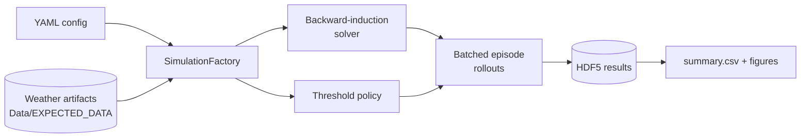

# Solar-Simulator Wiki

Reference wiki for **AHABS** (*Autonomous Hydrofauna Aerial Biome Surveyor*), a simulation
framework for a solar-powered seaplane that does long-term ocean monitoring such as whale
observation. The aircraft spends most of its time moored on the water, charging from its
solar array, and periodically takes off to fly and look for whales.

The mission is modelled as a **finite-horizon Markov decision process (MDP)**. Wind, solar
and whale-observation distributions depend on the location and season. The framework compares
energy-management policies by how many observations they collect over a mission:

- the **optimal** policy, solved by analytical backward induction;
- simple **threshold** policies.

!!! info "What this wiki describes"
    This wiki documents the `docs-wiki` branch, cut from `observation-model-fidelity`,
    including work in progress on that branch that is not yet committed. Pages marked
    *in progress* describe code that is present but not yet committed.

## The model in one paragraph

| Part | What it is |
|---|---|
| **State** | Battery state of charge (SoC, %) and a mode: `moored` or `flying`, plus an absorbing `broken` state. When a weather chain is enabled, the state also includes the current exogenous weather bin. |
| **Actions** | Binary: stay/land (`0`) or take off/keep flying (`1`). |
| **Each stage** (15 min by default) | The battery gains solar energy and pays the energy cost of the chosen action. |
| **Failure** | A wind-dependent success probability decides whether the action fails, which sends the aircraft to `broken`. Running the battery below empty also sends it to `broken`. |
| **Reward** | Earned while flying: the stage's whale-observation probability. Entering `broken` costs a configurable failure penalty. |

See [The MDP](architecture/mdp.md) for the exact definitions.

## Where to start

| If you want to... | Read |
|---|---|
| Install the environment and build this wiki | [Installation](getting-started/index.md) |
| Run your first experiment | [First run](getting-started/first-run.md) |
| Understand how the code fits together | [Architecture](architecture/index.md) |
| Look up a model feature and its config switch | [Models overview](models/index.md) |
| Write or modify an experiment config | [Config reference](experiments/config-reference.md) |
| Understand the result files | [Result storage](architecture/storage.md), [Outputs](experiments/outputs.md) |
| Check how a feature was verified | [Verification](verification/index.md) |
| Read why a design decision was made | [Design records](design/index.md) |
| Look up a class or function | [API reference](api/index.md) |

## Wiki layout

- **Getting started**: installation, a first run, and conventions for agents.
- **Architecture**: the MDP, the solver, episode simulation, and result storage.
- **Models**:
    - aircraft: power model, takeoff, transition probabilities;
    - solar: panel, clear-sky models;
    - weather: data pipeline, iid / chain / historical modes, wind and solar persistence chains;
    - mission: whale observation and policies.
- **Experiments**: the YAML harness, config keys, example configs, sweeps, outputs, figures, and GUI/tools.
- **Verification**: the verification method and a catalogue of what each check proves.
- **Design records**: the mathematical and design documents behind each feature, with a decision log and findings.
- **Reference**: glossary, project context, and the generated API reference.

!!! todo "Owner input needed"
    Project and mission context beyond the paragraph above (funding, collaborators,
    deployment plans, roadmap) is not recorded in the repository. See
    [Project context](reference/project-context.md).
