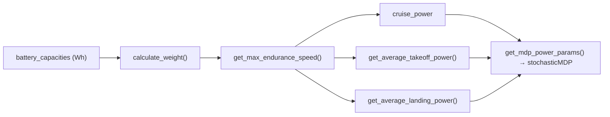

# Aircraft power model

The MDP needs only four numbers from the aircraft: the average electrical power drawn in each
kind of 15-minute stage. They come from `Seaplane` in `SolarSimulator/BaseClasses/seaplane_base.py`
([API](../api/baseclasses/seaplane_base.md)), a steady-state propulsion-power model with the
constant lift-to-drag formulation of Dantsker et al. (2018, doi:10.2514/6.2018-5009) for climb and
descent.



## How the simulator builds the aircraft

`SimulationFactory._compute_power_params` in `run_sim.py` builds one `Seaplane` for each battery
capacity in the sweep:

```python
Seaplane(lat=..., lon=..., tz=..., capacity=capacity_wh / 22.2)
```

`capacity` is in amp-hours at the default pack voltage of 22.2 V, so `capacity_Wh = voltage × capacity`
is the configured Wh value. Because battery mass is part of the aircraft weight, **every power term depends on battery
capacity**.

## Parameters

Constructor arguments and the constants set in `__init__`. No YAML key exposes any of them; the
harness always uses these defaults.

| Symbol | Attribute | Value | Meaning |
|---|---|---|---|
| $C_{D0}$ | `cd0` | 0.01 | Zero-lift (parasite) drag coefficient |
| — | `cdtot` | 0.06 | Stored; not used by the power equations |
| $S$ | `S` | 0.66 m² | Wing area |
| $V_b$ | `voltage` | 22.2 V | Pack voltage |
| $AR$ | `AR` | 8.0 | Aspect ratio |
| $e$ | `e` | 0.8 | Oswald efficiency |
| $k$ | `k` | $1/(\pi\,AR\,e) \approx 0.0497$ | Induced-drag factor |
| $\eta_m$ | `motor_efficiency` | 0.9 | Motor efficiency |
| $\eta_p$ | `propeller_efficiency` | 0.8 | Propeller efficiency |
| $P_\text{inst}$ | `INSTALLED_PROPULSION_POWER` | 4000 W | Installed propulsion power (mass and liftoff energy) |
| $h_c$ | `cruise_altitude` | 300 m | Cruise altitude |
| $(L/D)$ | `L_2_D_RATIO` (local) | 28 | Lift-to-drag ratio used in climb/descent |
| — | `idle_power` | 0 W | Moored housekeeping draw |
| — | `mean_chord` | 0.33 m | Used only by `get_reynolds_number` |

!!! todo "Owner input needed"
    Record where these airframe numbers come from (the reference aircraft, datasheets, or design
    study behind $S$, $C_{D0}$, $AR$, $e$, the efficiencies, $P_\text{inst}$ and the mass
    fractions below). The code gives no sources for most of them. The exceptions: the PV mass
    and $p_{dc0}$ comments cite "an ascent solar bare module – mid scale", and the climb model
    cites Dantsker et al. (2018).

## Weight

`calculate_weight(energy_density=150)` sums the component masses and scales them by a structural
fraction $k_\text{str} = 0.6$:

$$
m = \frac{m_\text{payload} + m_\text{pv} + m_\text{fcs} + m_\text{prop} + m_\text{batt}}{1 - k_\text{str}},
\qquad W = 9.81\,m
$$

| Term | Expression | Value |
|---|---|---|
| $m_\text{batt}$ | $\text{capacity}_\text{Wh} / 150$ (150 Wh/kg) | varies |
| $m_\text{payload}$ | constant | 1.35 kg |
| $m_\text{pv}$ | $S \cdot 0.0039 / 0.034$ | ≈ 0.076 kg |
| $m_\text{fcs}$ | constant (flight-control system) | 0.2 kg |
| $m_\text{prop}$ | $0.288\,P_\text{inst}/1500$ | ≈ 0.768 kg |

## Air density

`rho(h)` is the ISA troposphere:

$$
T = 288.15 - 0.0065\,h,\qquad p = 101325\,(T/288.15)^{5.2561},\qquad \rho = \frac{p}{287.05\,T}
$$

At the 300 m cruise altitude, $\rho \approx 1.190$ kg/m³.

## Cruise speed and power

The aircraft cruises at the **maximum-endurance speed**, found with `get_max_endurance_speed()` at
$\rho(h_c)$:

$$
U_E = \sqrt{\frac{2W}{\rho S}\sqrt{\frac{k}{3C_{D0}}}}
$$

Level-flight propulsion power (`get_propulsion_power(U, rho)`) is parasite power plus induced
power, divided by the drivetrain efficiency:

$$
P_\text{level}(U,\rho) = \frac{\tfrac12\rho U^3 S C_{D0} + \dfrac{2W^2k}{\rho U S}}{\eta_m\,\eta_p}
$$

`cruise_power` $= P_\text{level}(U_E, \rho(300))$.

## Climb and descent

`climb_power` and `descent_power` scale the level power for a flight-path angle $\gamma$:

$$
P_\text{climb} = P_\text{level}\,[\cos\gamma + (L/D)\sin\gamma],\qquad
P_\text{descent} = P_\text{level}\,[\cos\gamma - (L/D)\sin\gamma]
$$

`climb_energy(U, γ, h0, h1, dt)` and `descent_energy(...)` march through altitude in 1 s steps.
Each step re-evaluates $\rho(h)$, adds $P\,\Delta t$ to the energy, and moves altitude by
$U\sin\gamma\,\Delta t$. Each returns `(energy_J, time_s)`. Takeoff uses $\gamma = +2°$ from
0 to 300 m, and landing uses $\gamma = -2°$ from 300 m to 0.

## Stage powers passed to the MDP

`get_mdp_power_params()` returns the dictionary the MDP consumes. Each value is an average over
one stage of `TIMESTEP_MIN = 15` minutes.

| Key | Definition in code |
|---|---|
| `idle_power` | `idle_power` (0 W) |
| `cruise_power` | $P_\text{level}(U_E, \rho(300))$ |
| `takeoff_power` | $\big[E_\text{climb} + P_\text{cruise}(900 - t_\text{climb}) + E_\text{liftoff}\big]/900$, with $E_\text{liftoff} = 8\,P_\text{inst}$ (8 s at installed power) |
| `landing_power` | $E_\text{descent} / 900$ |

The takeoff and landing values are cached when `update_plane()` runs.

### Example values (code defaults)

Computed from `seaplane_base.py` with its defaults:

| Capacity (Wh) | Mass (kg) | $U_E$ (m/s) | cruise (W) | takeoff (W) | landing (W) | climb / descent time (s) |
|---|---|---|---|---|---|---|
| 300 | 10.98 | 18.80 | 144.9 | 251.4 | 144.7 | 458 / 458 |
| 500 | 14.32 | 21.46 | 215.6 | 343.6 | 188.5 | 401 / 401 |
| 1000 | 22.65 | 26.99 | 429.0 | 610.9 | 298.4 | 319 / 319 |

## Maneuver times and cruise fractions

`get_maneuver_times_s()` returns the climb and descent durations from the same models. The
harness uses them when `takeoff_cruise_fraction` or `landing_cruise_fraction` is set to `auto`.
`SimulationFactory._resolve_cruise_fractions` then sets

$$
f_\text{takeoff} = \max\!\big(0,\;1 - t_\text{climb}/\Delta t\big),\qquad
f_\text{landing} = \max\!\big(0,\;1 - t_\text{descent}/\Delta t\big)
$$

For example, at 500 Wh both fractions come out ≈ 0.554. See
[Whale observation](whale-observation.md) for how the fractions scale the reward.

## How the powers become energy

`StochasticTransitionLogic._calculate_energy_consumption` (`transition_model_base.py`) turns the
powers into per-stage energy draws, indexed by (mode, action):

| Mode \ action | 0 | 1 |
|---|---|---|
| moored (0) | $P_\text{idle}\Delta t$ | $(P_\text{takeoff}+P_\text{idle})\Delta t$ |
| flying (1) | $(P_\text{landing}+P_\text{idle})\Delta t$ | $(P_\text{cruise}+P_\text{idle})\Delta t$ |
| broken (2) | 0 | 0 |

Here $\Delta t$ is `delta_t` in seconds. Solar energy gain is added separately; see
[Solar panel models](solar-panel.md).

## Other methods

- `get_reynolds_number(U, altitude)` uses Sutherland's law for viscosity and the mean chord. It is diagnostic only.
- `get_lift_coefficient(rho, U)` returns $W / (\tfrac12\rho U^2 S)$.
- `get_total_mass(directory)` reads a `Total Mass` line from a `*mass*` file. The MDP path does not use it.
- `calculate_pdc0()` sets `pdc0` $= S \cdot 3.3/0.034$ W. The panel models on [Solar panel models](solar-panel.md) are separate and do not use it.

The standalone takeoff-run physics (hull hydrodynamics, motor maps) lives in
[Takeoff simulation](takeoff.md). It does not feed these MDP powers.
