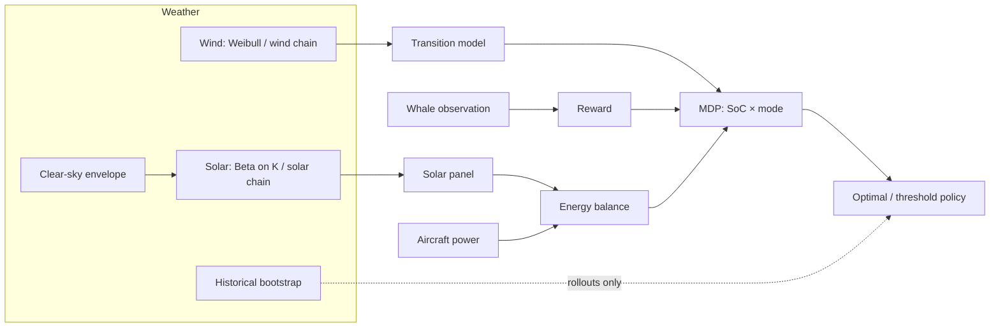

# Models overview

The simulator is a finite-horizon MDP for a solar-powered seaplane surveying for whales. At each
15-minute stage the vehicle is moored, flying or broken. It chooses to take off, stay moored,
continue flying or land. Solar input charges the battery, the aircraft power model drains it,
wind sets the risk of each maneuver, and the whale observation series sets the reward.
[The MDP](../architecture/mdp.md) gives the formal definition. This section documents each model
that feeds it.

## Model pages

| Area | Page | Code |
|---|---|---|
| Aircraft | [Power model](aircraft-power.md) | `BaseClasses/seaplane_base.py` |
| | [Takeoff simulation](takeoff.md) (standalone study) | `TakeoffSimulation/` |
| | [Transition models](transition-models.md) | `BaseClasses/transition_model_base.py` |
| Solar | [Solar panel](solar-panel.md) | `BaseClasses/solar_panel_base.py` |
| | [Clear-sky models](clearsky.md) | `BaseClasses/clearsky_models.py` |
| Weather | [Weather data pipeline](weather-data.md) | `Scripts/create_weather_distributions.py`, `BaseClasses/weather_processor_cs_normalization.py` |
| | [Weather modes](weather-modes.md) | `BaseClasses/environment_provider_base.py` |
| | [Wind persistence chain](wind-chain.md) | `environment_provider_base.py`, `backward_induction_base.py` |
| | [Solar persistence chain](solar-chain.md) | same, plus `run_sim.EnvironmentLoader` |
| Mission | [Whale observation](whale-observation.md) | `BaseClasses/whale_base.py`, `BaseClasses/mdp_base.py` |
| | [Policies](policies.md) | `BaseClasses/simulation_base.py` |

## Feature matrix

These are the YAML keys that choose a model. Each default reproduces the original model; see
[Defaults reproduce the original model](#defaults-reproduce-the-original-model) below.
[Config reference](../experiments/config-reference.md) lists every other key.

| Config key | Options | Default | Page |
|---|---|---|---|
| `transition_model` | `moderate`, `some`, `realistic`, `optimistic`, `linear`, `nowind`, `nofail`, `test`, `wind based` | `moderate` | [Transition models](transition-models.md) |
| `solar_panel_model` | `constant`, `pvwatts`, `variable` | `constant` | [Solar panel](solar-panel.md) |
| `solar_panel_kwargs` | constructor kwargs (dict) | none | [Solar panel](solar-panel.md) |
| `clearsky_model` | `fatemi`, `haurwitz`, `ineichen` | `fatemi` | [Clear-sky models](clearsky.md) |
| `wind_chain.enabled` | `true` / `false` | `false` (i.i.d. Weibull wind) | [Wind persistence chain](wind-chain.md) |
| `wind_chain.n_bins` / `.bin_edges` / `.path` | quantile bin count, or explicit interior edges (m/s); artifact path | `n_bins: 3`, edges none, derived path | [Wind persistence chain](wind-chain.md) |
| `solar_chain.enabled` | `true` / `false` | `false` (i.i.d. per-stage Beta) | [Solar persistence chain](solar-chain.md) |
| `solar_chain.n_bins` / `.path` | stage-quantile bin count; artifact path | `n_bins: 3`, derived path | [Solar persistence chain](solar-chain.md) |
| `historical_weather.enabled` | `true` / `false` | `false` (roll out on fitted distributions) | [Weather modes](weather-modes.md) |
| `historical_weather.block_length_days` / `.path` | bootstrap block length; cube path | `7`, derived path | [Weather modes](weather-modes.md) |
| `whale_series` | `JoA2026`, `custom`, `encounter`, `constant`, `sinusoidal` (`real` is a deprecated alias of `JoA2026`) | `JoA2026` | [Whale observation](whale-observation.md) |
| `whale_block_values`, `whale_block_hours` | per-block values; block length (h) | built-in profile, 2 h | [Whale observation](whale-observation.md) |
| `whale_species`, `whale_platform`, `whale_light`, `locations[].density_per_km2` | encounter-model options | see page | [Whale observation](whale-observation.md) |
| `takeoff_cruise_fraction` | $[0,1]$ or `auto` | `1.0` | [Whale observation](whale-observation.md), [Aircraft power](aircraft-power.md) |
| `landing_cruise_fraction` | $[0,1]$ or `auto` | `0.0` | same |
| `threshold_values`, `wind_thresholds` | lists of thresholds | `[]` (no threshold sims) | [Policies](policies.md) |
| `include_optimal` | `true` / `false` | `true` | [Policies](policies.md) |

Not configurable: the airframe parameters in `Seaplane` (fixed defaults) and the discount
$\gamma = 1$.

## Defaults reproduce the original model

Each switch is designed so that its default, or a degenerate setting, reduces **exactly** to the
model that existed before the feature was added. A `Tests/verify_*.py` script proves each
reduction; see [Verification](../verification/index.md).

| Feature | Reduction | Proven by |
|---|---|---|
| Clear-sky models | `fatemi` reproduces the original $A\cos z$ envelope and the stored `clearsky_irradiance` exactly; non-fatemi artifacts go to separate files | `verify_pvlib_solar.py` (checks 1, 5) |
| PVWatts panel | defaults (0.65 m², 65 W, 25 °C) give efficiency 0.1 → bit-identical sunlight draws to `constant` | `verify_pvlib_solar.py` (checks 3, 4) |
| Wind chain | off → 2-D value table, unchanged i.i.d. path; a rank-1 chain reproduces the Weibull marginal and i.i.d. rollout statistics within MC error | `verify_wind_chain.py` (checks 1–3) |
| Solar chain | off → unchanged i.i.d. path; a uniform (memoryless) chain over stage-quantile bins reproduces the stage-Beta marginal and i.i.d. rollouts; joint wind+solar with uniform solar factor matches wind-only | `verify_solar_chain.py` (checks 1, 2, 4) |
| Whale series | `JoA2026` block series equals the original repeat/tile construction; `custom` with built-in values and `encounter` in focal form ($g_0 = 1$, no density) give bit-identical value tables | `verify_whale_model.py` (checks 1, 4, 8) |
| Cruise fractions | default gain $[[0,1],[0,1],[0,0]]$ makes `reward` equal the original `actions * samples` | `verify_whale_model.py` (check 3) |
| Vectorized solver / batched rollouts | solver tables identical to the original scalar loop; batched episodes statistically equivalent | `verify_runtime_opt.py`, `verify_solver_speed.py` |

The design reasoning behind these features is recorded in [Design records](../design/index.md).
