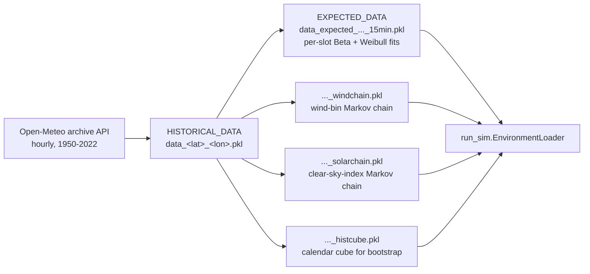

# Weather data pipeline

Every simulation is driven by per-location weather artifacts: pickles under `Data/`
built offline from an hourly historical record. This page covers where that record
comes from, what gets fitted to it, which files result, and how the harness builds any
that are missing.

!!! info "Where the files live"
    `Data/` is git-ignored. Artifacts are rebuilt on demand by the harness (see
    [Automatic provisioning](#automatic-provisioning)), so a fresh clone only needs network
    access to Open-Meteo the first time a location is used.

## Overview



All four derived artifacts come from the same hourly historical pickle. Only the
expected-data file is required; the other three are used only when their feature is
switched on in the config.

## 1. Historical record (Open-Meteo)

`WeatherDataProcessor.fetch_weather_data` (in both `Scripts/create_weather_distributions.py`
and `BaseClasses/weather_processor_cs_normalization.py`) calls the Open-Meteo archive API
(`https://archive-api.open-meteo.com/v1/archive`) with:

| Parameter | Value |
|---|---|
| Hourly variables | `wind_speed_10m`, `wind_direction_10m`, `shortwave_radiation` |
| Wind unit | `ms` (m/s) |
| Grid cell selection | `sea` |
| Time zone | `auto` (local time of the location) |
| Date range used by the harness | `1950-01-01` to `2022-12-31` |

`process_hourly_data` builds a DataFrame indexed by local timestamps and **drops every
Feb 29**, so each year has exactly 365 days and calendar slots line up across years.
Requests go through a `requests_cache` session (`.cache.sqlite`, never expiring) with
retries.

The result is saved as `Data/HISTORICAL_DATA/data_<lat>_<lon>.pkl`. When the harness looks
for an existing record it tries `data_{lat}_{lon}.pkl`, then `data_{int(lat)}_{int(lon)}.pkl`,
then any pickle in `HISTORICAL_DATA/` whose name contains both coordinates
(`harness/run_experiment.py: _find_historical_pkl`).

## 2. Expected-data artifact (per-slot distributions)

This is the file named by `locations[].data_path` in a config, e.g.
`Data/EXPECTED_DATA/data_expected_lat30.0_lon-90.0_15min.pkl`. It is built by
`build_expected_data_artifact` in
[`weather_processor_cs_normalization`](../api/baseclasses/weather_processor_cs_normalization.md):

1. Resample the hourly record to the model timestep (`delta_t`, default 15 min) with
   linear interpolation.
2. Group by calendar slot `(month, day, hour, minute)` across all years.
3. For each slot fit:
    - **Solar**: a Beta distribution to the clear-sky-normalized irradiance
      $K = \text{GHI} / G_{cs}$, where $G_{cs}$ is the clear-sky envelope at the slot
      (see [Clear-sky models](clearsky.md)).
    - **Wind**: a two-parameter Weibull (`weibull_min.fit(..., floc=0)`) to 10 m wind speed.

The resulting DataFrame has one row per calendar slot with columns:

| Column | Meaning |
|---|---|
| `month`, `day`, `hour`, `minute` | Calendar slot (365-day year, no Feb 29) |
| `beta_alpha`, `beta_beta` | Beta parameters of the clear-sky index $K$ |
| `clearsky_irradiance` | $G_{cs}$ for the slot, W/m² |
| `expected_solar_rad` | Beta mean $\times\ G_{cs}$, W/m² |
| `weibull_k`, `weibull_loc`, `weibull_scale` | Weibull fit (loc fixed at 0) |
| `expected_wind_speed` | Weibull mean, `scale * Γ(1 + 1/k)` |

### Beta fit details (`WeatherDataProcessor._fit_beta`)

- $G_{cs}$ is evaluated at the slot's first timestamp with the configured clear-sky model.
- A Beta is fitted only when $G_{cs} > 50$ W/m². Below that (night and deep twilight) the
  slot gets the placeholder `(alpha, beta) = (1.0, 1000.0)` and an expected irradiance of 0.
- Normalized values are clipped to $(10^{-7}, 0.999999)$ and fitted by **method of moments**
  (`fit_beta_mom`): with sample mean $\mu$ and variance $v$,
  $\kappa = \mu(1-\mu)/v - 1$, $\alpha = \mu\kappa$, $\beta = (1-\mu)\kappa$.
- Two degenerate cases get a near-point-mass Beta with concentration $\kappa_0 = 10^6$:
  every sample at or above clear sky (mean pinned at $1 - 10^{-6}$), and all samples
  identical (mean at that value).

### Which processor is which

| Module | Role |
|---|---|
| `BaseClasses/weather_processor_cs_normalization.py` | Current expected-data builder: pluggable clear-sky envelope, method-of-moments Beta. Used by the harness. |
| `Scripts/create_weather_distributions.py` | Open-Meteo fetch used by the harness, plus every chain and cube builder (sections 3–5). Its own `WeatherDataProcessor` also carries a Fatemi-normalized maximum-likelihood fitting path. |
| `BaseClasses/weather_processor.py` | The earlier processor, kept for reference; nothing else in the codebase imports it. |

## 3. Wind-chain artifact

`fit_wind_transition_chain` / `build_wind_chain_artifact` in
`Scripts/create_weather_distributions.py`. CLI: `Scripts/build_windchain.py`.

The hourly wind is resampled to the model timestep, binned, and consecutive
(source → destination) bin pairs are counted per `(month, hour)`. Rows are normalized; rows
with no observations become uniform.

| Key | Shape / type | Meaning |
|---|---|---|
| `n_bins` | int | Number of wind bins |
| `bin_edges` | `(n_bins + 1,)` | Full edge array `[0, e1, …, inf]`, m/s |
| `quantile_derived` | bool | `True` if edges came from equal-occupancy quantiles |
| `conditioning` | tuple | Always `("month", "hour")` |
| `transition_by_month_hour` | `(13, 24, n_bins, n_bins)` | Row-stochastic matrices; index `[month, hour]`, months 1–12 used |

See [Wind persistence chain](wind-chain.md).

## 4. Solar-chain artifact

`fit_solar_transition_chain` / `build_solar_chain_artifact` in the same module. CLI:
`Scripts/build_solarchain.py` (needs `--lat`/`--lon` for solar geometry).

| Key | Shape / type | Meaning |
|---|---|---|
| `kind` | `"solar"` | Artifact type tag |
| `n_bins` | int | Number of stage-relative quantile bins |
| `bin_mode` | `"stage_quantile"` | Bins are quantile bands of each stage's own distribution |
| `conditioning` | tuple | `("month", "hour")` |
| `transition_by_month_hour` | `(13, 24, n_bins, n_bins)` | Intra-day transitions between consecutive solar-valid slots |
| `dawn_transition_by_month` | `(13, n_bins, n_bins)` | Dusk of day *d* → dawn of day *d+1*, indexed by the dawn day's month |
| `valid_threshold_wm2` | float | $G_{cs}$ gate (default 200 W/m²) that defines where the index exists |
| `clearsky_model` | str | Envelope used to form the index |

See [Solar persistence chain](solar-chain.md).

## 5. Historical calendar cube

`build_historical_cube_artifact` in the same module. CLI: `Scripts/build_histcube.py`.

The hourly record is resampled to the model timestep, Feb 29 is dropped (again, after
interpolation), and wind and GHI are packed into arrays indexed by
(calendar slot, year):

| Key | Shape / type | Meaning |
|---|---|---|
| `wind_cube` | `(slots_per_year, n_years)` | Wind speed, m/s (NaN where missing) |
| `solar_cube` | `(slots_per_year, n_years)` | GHI, W/m² |
| `slots_per_year` | int | `365 * 1440 / delta_t` (35,040 at 15 min) |
| `years`, `n_years` | list, int | Years present in the record |
| `delta_t_min` | int | Timestep; must equal the simulation's `delta_t` |

Used by the [historical weather mode](weather-modes.md).

## File naming

Every derived path is computed from `locations[].data_path` by functions in
[`run_sim`](../api/baseclasses/run_sim.md):

| Function | Rule | Example (`data_expected_lat30.0_lon-90.0_15min.pkl`) |
|---|---|---|
| `_resolve_data_path` | Inserts `_<model>` for any `clearsky_model` other than `fatemi` | `..._15min_ineichen.pkl` |
| `_derive_chain_path` | Inserts `_windchain` | `..._15min_windchain.pkl` |
| `_derive_solar_chain_path` | Inserts `_solarchain` | `..._15min_solarchain.pkl` |
| `_derive_histcube_path` | Inserts `_histcube` | `..._15min_histcube.pkl` |

Derived paths are computed from the *resolved* data path, so they inherit the
clear-sky suffix (e.g. `..._15min_ineichen_solarchain.pkl`). Artifacts built with different
clear-sky envelopes are not interchangeable. Each chain or cube block accepts an explicit
`path:` that overrides the derived name.

## Automatic provisioning

`harness/run_experiment.py: _ensure_location_data` runs for every location before an
experiment starts. It:

1. Resolves the data path for the configured `clearsky_model`.
2. Checks the expected-data file, plus the wind-chain, solar-chain and cube files when
   their blocks are enabled.
3. Treats a chain artifact as **stale**, and rebuilds it, when:
    - **wind**: explicit `bin_edges` differ from the stored edges; or, in quantile mode,
      `n_bins` differs or the stored artifact was built from explicit edges
      (`quantile_derived` is false);
    - **solar**: `n_bins` differs, or the stored `clearsky_model` differs from the config.

    The stale check is skipped when the block gives an explicit `path`.
4. Finds the historical pickle, or fetches it from Open-Meteo (1950–2022) if there is none.
   This needs `latitude` and `longitude` in the location entry.
5. Builds whatever is missing, at the config's `delta_t`.

Progress lines are prefixed `[provision]`.

## Building artifacts by hand

From `SolarSimulator/`, in the `pvlib` env:

```bash
python Scripts/build_windchain.py  --historical Data/HISTORICAL_DATA/data_30_-90.pkl \
    --out Data/EXPECTED_DATA/data_expected_lat30.0_lon-90.0_15min_windchain.pkl --n-bins 4
python Scripts/build_solarchain.py --historical Data/HISTORICAL_DATA/data_30_-90.pkl \
    --lat 30.0 --lon -90.0 \
    --out Data/EXPECTED_DATA/data_expected_lat30.0_lon-90.0_15min_solarchain.pkl --n-bins 3
python Scripts/build_histcube.py   --historical Data/HISTORICAL_DATA/data_30_-90.pkl \
    --out Data/EXPECTED_DATA/data_expected_lat30.0_lon-90.0_15min_histcube.pkl --dt 15
```

All flags are listed in the [Scripts API page](../api/scripts.md).

## Caveat: interpolation and short-lag persistence

The record is hourly and is linearly interpolated to 15 min before any chain is fitted.
The `fit_wind_transition_chain` and `fit_solar_transition_chain` docstrings note that this
inflates short-lag persistence: the diagonal of the intra-day transition matrices overstates
real 15-minute persistence. The solar dusk→dawn matrix is not affected.
